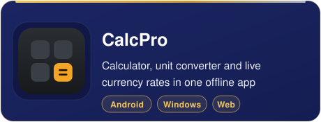
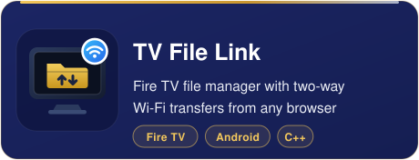
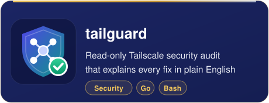
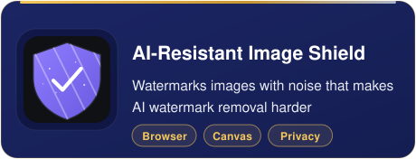
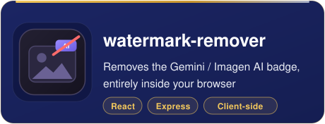

  

  <b>I build small, practical tools that solve one job well:</b> apps for phones, TVs and desktops,
  security checks that explain every fix in plain English, and automation that sets up servers for you. 
  Everything here is open source, works offline where it can, and keeps your data on your own device.

  
  
  

## Featured projects

  
  
  
  
  
  

## Tech stack

**Apps and web**

  
  
  
  
  
  
  

**Languages and scripting**

  
  
  
  
  
  

**Servers, networks and security**

  
  
  
  
  
  
  

## How I build

- **Privacy first.** No accounts, analytics or tracking. Data stays on your device; the only network calls are the ones the tool needs.
- **Works offline.** Apps keep working without a connection and say clearly when they are using saved data.
- **Explained, not just fixed.** Security tools tell you what they found, why it matters and exactly how to fix it.
- **Tested before release.** Automated tests, emulator runs and a leak and safety scan before anything is published, with checksums for every download.

   
  Prepared by Anshuva Samanta

